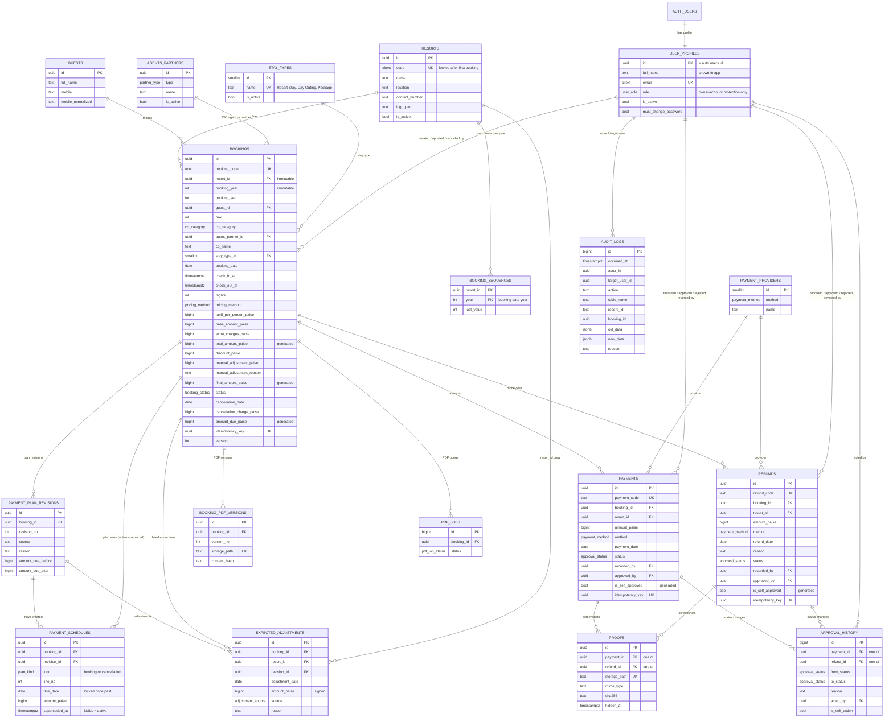

# ER_DIAGRAM — Entity Relationships

Status: M0 final draft. Renders on GitHub (Mermaid). Column details are in DATABASE_SCHEMA.md.

## Relationship notes
- **Resort → Booking → Payments / Refunds** is the main chain. `payments.resort_id` and `refunds.resort_id` are trigger-checked copies of the booking's resort, used for fast reports.
- `booking_sequences` has one row per resort per booking-date year (Q4).
- **Proofs** and **approval history** are shared by payments and refunds. Each row belongs to exactly one of them (CHECK).
- **Append-only:** `approval_history`, `booking_pdf_versions`, `audit_logs`, `payment_plan_revisions`, `expected_adjustments`, superseded `payment_schedules` rows, and past due `payment_schedules` rows (locked, D2).
- **Expected collection** = active plan rows (by due date) + expected adjustments (by adjustment date). Their total per booking always equals `bookings.amount_due_paise`.
- `user_profiles.role` affects only Owner-account protection. At least one active Owner always exists.
- Files (logos, proofs, PDFs) live in Supabase Storage. The tables hold paths and metadata only.
- `audit_logs.booking_id` and `audit_logs.target_user_id` are plain columns (not FKs), so the log is never blocked by schema changes.
